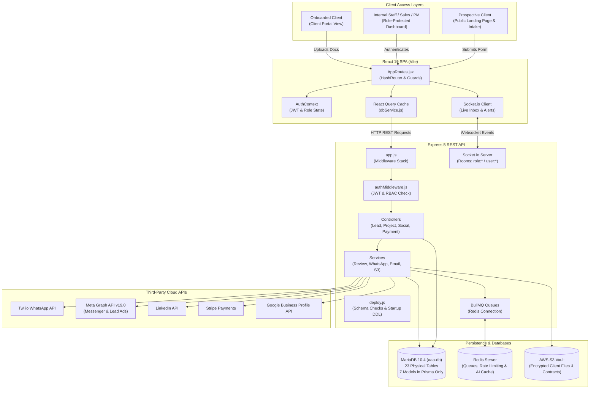

# Project Overview: AAA IT CRM Architecture & Business Domain

**Document ID:** `KB-DOC-002`  
**Module:** System Architecture / Overview  
**Evidence Level:** `CONFIRMED_FROM_CODE` & `CONFIRMED_FROM_READ_ONLY_DATABASE`  

---

## 1. Business Context & System Purpose

The **AAA IT CRM** platform is an enterprise-grade Customer Relationship Management, Project Delivery, and Omnichannel Communications system. Originally developed for an international legal and immigration advisory consultancy (specializing in Spanish residency, Digital Nomad Visas, and sworn translations), the system has undergone strategic re-engineering to power a B2B **Information Technology Services Company**.

The platform is designed to manage the entire B2B IT commercial and operational lifecycle:
1. **Inbound Client Capture**: Enterprise project discovery, public inquiry forms, and ad-driven lead ingestion across Meta (Facebook/Instagram), WhatsApp, LinkedIn, and website portals.
2. **Lead Qualification & Commercial Scoping**: Requirements gathering, tech stack assessment, budget qualification, deal value estimation, and sales pipeline progression.
3. **Discovery Call Booking**: Automated appointment scheduling, timezone normalization, and calendar sync between prospective clients and solutions architects.
4. **Project Delivery & Engineering Operations**: Milestone tracking, sprint task assignments, engineer time logging, and formal handover sign-offs.
5. **Omnichannel Messaging & Social Inbox**: Unified bi-directional real-time communication across WhatsApp Business, Meta Messenger, Instagram DMs, Telegram, and customer SMS/email.
6. **Billing & Invoicing**: Multi-currency commercial deals, Stripe credit card checkouts, GCC Buy-Now-Pay-Later (Tabby & Tamara) installment integrations, and automated receipt generation.
7. **Reputation & Review Management**: Multi-provider reputation monitoring across Google Business Profile, Clutch.co, Trustpilot, and Meta reviews, powered by automated sentiment classification NLP.

---

## 2. Complete Technology Stack

```
+----------------------------------------------------------------------------------------------------+
|                                         AAA IT CRM PLATFORM                                        |
+----------------------------------------------------------------------------------------------------+
|  FRONTEND SPA                                                                                      |
|  - Framework: React 19.2.6 (Vite 8.0.12 Build Tooling)                                             |
|  - UI Component Library: Material-UI v9.1.1 (@mui/material, @mui/icons-material, @emotion/styled)    |
|  - Routing: React Router v7.18.0 (HashRouter Architecture)                                         |
|  - State Management: @tanstack/react-query 5.101.0 (Asynchronous Server State)                      |
|  - Real-Time Websockets: Socket.io-client 4.8.3                                                    |
|  - Data Visualization: Recharts 3.8.1 (Sales Conversion & Pipeline Metrics)                        |
|  - Anti-Fraud & Fingerprinting: @fingerprintjs/fingerprintjs 5.2.0                                 |
|  - Forms & Validation: React Hook Form 7.79.0 + Yup 1.7.1                                          |
|  - Styling: Tailwind CSS 4.3.1 + PostCSS 8.5.16 + Custom MUI Palette Themes                        |
+----------------------------------------------------------------------------------------------------+
                                      |  (REST API / JSON / Multipart Form-Data / Socket.IO)
                                      v
+----------------------------------------------------------------------------------------------------+
|  BACKEND API & WORKERS                                                                             |
|  - Runtime: Node.js (v20+ / v24 verified)                                                          |
|  - Web Framework: Express.js 5.2.1 (RESTful JSON API)                                             |
|  - Database ORM: Prisma ORM 6.4.1 (MySQL/MariaDB Connector)                                       |
|  - Primary Relational Database: MariaDB 10.4.32 (Database: aaa-db on port 3306)                     |
|  - Asynchronous Queues & Cache: Redis (ioredis 5.11.1) + BullMQ 5.79.2                             |
|  - Bi-Directional Event Server: Socket.IO 4.8.3 (Room-based Role & User Broadcasting)             |
|  - Cryptographic Vault: Node.js Crypto (AES-256-GCM Authenticated Encryption for Provider Keys)    |
|  - Authentication: JWT (jsonwebtoken 9.0.3) + Salted Password Hashing (bcrypt 6.0.0)               |
+----------------------------------------------------------------------------------------------------+
                                      |  (External Protocols & Cloud Gateways)
                                      v
+----------------------------------------------------------------------------------------------------+
|  EXTERNAL INFRASTRUCTURE & INTEGRATIONS                                                            |
|  - Object Storage: AWS S3 (@aws-sdk/client-s3 3.1079.0, presigned upload URLs)                     |
|  - Payment Gateways: Stripe 22.3.2, Tabby REST API, Tamara REST API                                |
|  - Messaging Channels: Twilio WhatsApp 6.0.2, Meta Graph API v19.0 (FB/IG DMs), Telegram Bot API   |
|  - Email Transports: Resend API 6.17.2, Nodemailer 9.0.3 (SMTP with DKIM/SPF)                       |
|  - Professional Lead Sync: LinkedIn Marketing API (Lead Gen Forms & REST Messages)                |
|  - Document Processing: unpdf 1.6.2 (Client PDF Parsing & Word Extraction)                         |
+----------------------------------------------------------------------------------------------------+
```

---

## 3. High-Level System Architecture Diagram



---

## 4. Operational Boundaries and Environments

| Environment Parameter | Configuration / Behavior | Source Evidence |
| :--- | :--- | :--- |
| **Default Port** | `5000` (configurable via `process.env.PORT`) | [`backend/src/app.js:95`](file:///d:/Kiaan/aaa-merging/backend/src/app.js#L95) |
| **Startup Entry Point** | `node deploy.js` (runs DDL schema checks before requiring `app.js`) | [`backend/package.json:8`](file:///d:/Kiaan/aaa-merging/backend/package.json#L8)<br>[`backend/deploy.js:282-301`](file:///d:/Kiaan/aaa-merging/backend/deploy.js#L282-L301) |
| **Development Script** | `nodemon src/app.js` | [`backend/package.json:7`](file:///d:/Kiaan/aaa-merging/backend/package.json#L7) |
| **Frontend Dev Server** | `vite` (Default port `5173`) | [`frontend/package.json:6`](file:///d:/Kiaan/aaa-merging/frontend/package.json#L6) |
| **Default API URL** | `http://localhost:5000/api/v1` or Railway production fallback | [`frontend/src/services/dbService.js:3`](file:///d:/Kiaan/aaa-merging/frontend/src/services/dbService.js#L3) |
| **Database Connection** | MariaDB via MySQL protocol `DATABASE_URL` in `.env` | [`backend/prisma/schema.prisma:2-5`](file:///d:/Kiaan/aaa-merging/backend/prisma/schema.prisma#L2-L5) |
| **Redis Dependency** | Optional fallback (`DISABLE_REDIS=true` triggers `MockQueue` in-memory) | [`backend/src/queues/queueSetup.js:16-38`](file:///d:/Kiaan/aaa-merging/backend/src/queues/queueSetup.js#L16-L38) |
| **Third-Party API Fallback** | Twilio, Meta, and LinkedIn fall back to dry-run console simulation when tokens are missing | [`whatsappService.js:52-56`](file:///d:/Kiaan/aaa-merging/backend/src/services/whatsappService.js#L52-L56)<br>[`facebookService.js:28-31`](file:///d:/Kiaan/aaa-merging/backend/src/services/facebookService.js#L28-L31) |

