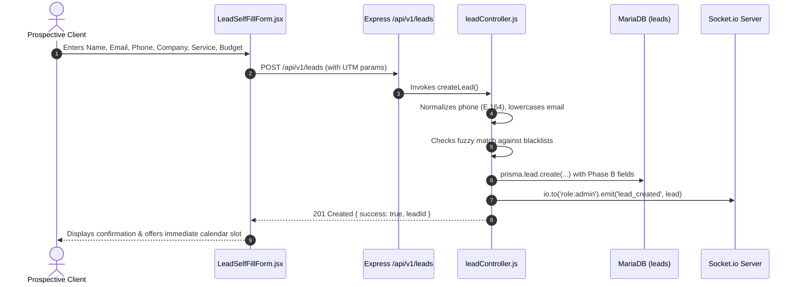
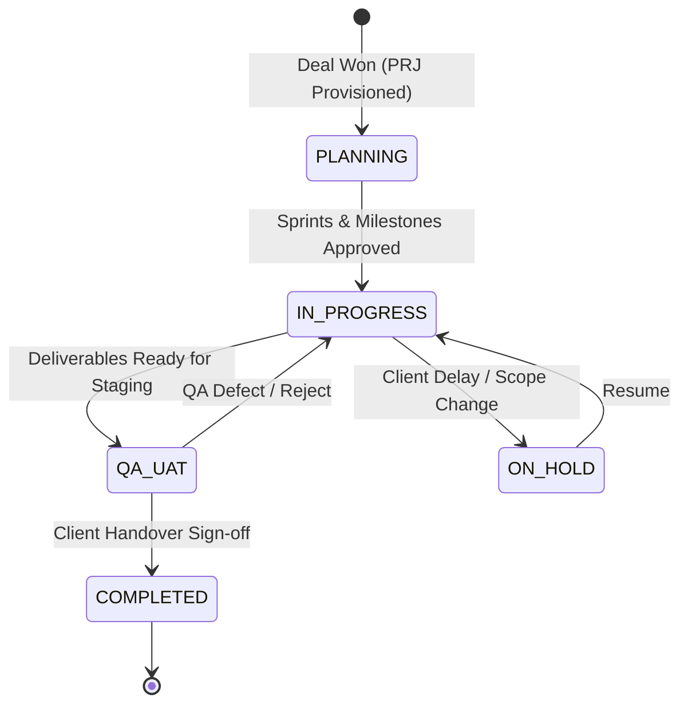

# End-to-End Business Workflows & State Machines

**Document ID:** `KB-DOC-008`  
**Module:** Business Logic & State Machines  
**Evidence Level:** `CONFIRMED_FROM_CODE`  

---

## 1. Workflow Index

```
W1: Inbound Lead Capture & Channel Attribution
W2: Lead Deduplication & Blacklist Filtering
W3: Discovery Consultation Booking & Availability Calculation
W4: Sales Pipeline Progression & Deal Commercials
W5: Lead-to-Client Account Conversion
W6: IT Project Delivery, Milestone Sprints & Time Tracking
W7: Payment Checkout, Stripe Webhook & Invoicing
W8: Omnichannel Inbound Chat & BullMQ Dispatch
W9: Reputation Review Sync, Sentiment Classification & Response
W10: Anti-Fraud Verification & Fingerprint Screening
```

---

### W1: Inbound Lead Capture & Channel Attribution

- **Trigger**: Client submits form on [`LandingPage.jsx`](file:///d:/Kiaan/aaa-merging/frontend/src/pages/public/LandingPage.jsx) or [`LeadSelfFillForm.jsx`](file:///d:/Kiaan/aaa-merging/frontend/src/pages/public/LeadSelfFillForm.jsx), or Meta Lead Ad fires webhook.
- **Inputs**: `firstName`, `lastName`, `email`, `phone`, `companyName`, `dealValue`, `currency`, `serviceType`, `budget`, `utm_source`, `utm_campaign`.
- **Validation**: Name, valid email regex, phone minimum 8 digits.
- **Database Mutation**: New row in `leads` table with `status = 'New Lead'`, Phase B commercial values, and attribution fields.
- **Side Effects**: Socket.IO alert broadcast to staff; queued notification job added to BullMQ.

---

### W2: Lead Deduplication & Blacklist Filtering
- **Trigger**: Execution of `leadController.createLead` ([`backend/src/controllers/leadController.js:215-260`](file:///d:/Kiaan/aaa-merging/backend/src/controllers/leadController.js#L215-L260)).
- **Mechanism**:
  1. Phone number is cleaned: local country codes (e.g. `050...`) converted to international E.164 format (`+97150...`) via `whatsappService.formatPhoneNumber`.
  2. Database queried for existing leads with exact matching phone or email.
  3. If exact match found: updates existing record's `timeline` JSON log without creating duplicate.
  4. Levenshtein distance similarity calculated on applicant name against `blacklisted_clients` table using [`fuzzyMatch.js`](file:///d:/Kiaan/aaa-merging/backend/src/utils/fuzzyMatch.js). If similarity exceeds 85%, lead is flagged as `SUSPICIOUS` and assignment is held.

---

### W3: Discovery Consultation Booking & Availability Calculation
- **Trigger**: Prospect or staff schedules meeting on [`LeadSelfFillForm.jsx`](file:///d:/Kiaan/aaa-merging/frontend/src/pages/public/LeadSelfFillForm.jsx) or [`CalendarView.jsx`](file:///d:/Kiaan/aaa-merging/frontend/src/pages/consultations/CalendarView.jsx).
- **Processing Logic** ([`consultationController.js:150-240`](file:///d:/Kiaan/aaa-merging/backend/src/controllers/consultationController.js#L150-L240)):
  1. Frontend fetches booked slots for target date via `GET /consultations`.
  2. Operating hours (09:00 - 18:00) sliced into 30-minute intervals.
  3. Already-booked slots for the selected consultant are disabled in UI.
  4. When submitted, backend checks `AgentSchedule` for holidays/vacations.
  5. Inserts record into `consultations` table with status `Inquiry Assigned` (if consultant assigned) or `Inquiry Received`.
  6. Updates `leads.status` to `Discovery Scheduled`.
  7. *Known Limitation*: `meetingLink` and `zoomMeetingId` are hardcoded to `null` on lines 257-258.

---

### W4: Sales Pipeline Progression & Deal Commercials
- **Trigger**: Sales representative conducts scoping session and updates lead in [`DealCommercialsCard.jsx`](file:///d:/Kiaan/aaa-merging/frontend/src/components/DealCommercialsCard.jsx) or [`SalesPipelineStepper.jsx`](file:///d:/Kiaan/aaa-merging/frontend/src/components/SalesPipelineStepper.jsx).
- **State Machine Transitions**:
  $$\text{New Lead} \longrightarrow \text{Contacted} \longrightarrow \text{Discovery Scheduled} \longrightarrow \text{Proposal Sent} \longrightarrow \text{Negotiation} \longrightarrow \begin{cases} \text{Deal Won} \\ \text{Lost} \end{cases}$$
- **Rules Enforced**:
  - `consultant` role can only view and update leads where `assignedToId === req.user.id`.
  - Advancing to `Proposal Sent` requires `dealValue > 0` and `currency` set.
  - Advancing to `Deal Won` updates `leads.status = 'Deal Won'` and immediately triggers Workflow W5.

---

### W5: Lead-to-Client Account Conversion
- **Trigger**: Lead transitions to `Deal Won` or contract is signed.
- **Processing Logic** ([`clientController.js:100-160`](file:///d:/Kiaan/aaa-merging/backend/src/controllers/clientController.js#L100-L160)):
  1. Sequence counter queried to generate human-readable client code: `CID-${12000 + count}`.
  2. Creates row in `clients` table referencing `leadId`, copying contact info, assigned consultant, and company name.
  3. Sets `clients.status = 'Active'`.
  4. Updates `leads.clientId` with the newly created client UUID.
  5. Issues temporary portal login credentials and triggers optional onboarding email.

---

### W6: IT Project Delivery, Milestone Sprints & Time Tracking
*(Implemented in `projectController.js`; physical MariaDB tables currently unmigrated)*

1. **Project Provisioning**: `POST /api/v1/projects` creates project linked to `clientId`, assigning `projectManagerId` and generating code `PRJ-2026-001`.
2. **Milestones**: `POST /projects/:id/milestones` creates delivery phases (e.g. *Phase 1: Architecture & UI Prototype*, 30% invoice).
3. **Task Assignment**: `POST /projects/:id/tasks` creates sprint items with priority (`URGENT`, `HIGH`, `MEDIUM`), estimated hours, and assigned engineer.
4. **Time Logging**: Engineers submit daily hours via `POST /projects/:id/time-logs`; `projects.spentBudget` is updated based on hourly rates.
5. **Formal Handover**: `POST /projects/:id/handovers` records production URLs, credentials vault link, and client acceptance signature.

---

### W7: Payment Checkout, Stripe Webhook & Invoicing
- **Trigger**: Client pays proposal invoice online or staff triggers payment link.
- **Processing Steps** ([`paymentController.js`](file:///d:/Kiaan/aaa-merging/backend/src/controllers/paymentController.js), [`webhookController.js:400-500`](file:///d:/Kiaan/aaa-merging/backend/src/controllers/webhookController.js#L400-L500)):
  1. `POST /payments/create-checkout-session` calls `stripe.checkout.sessions.create` with amount and success URL.
  2. Client redirected to Stripe hosted checkout.
  3. Upon payment, Stripe dispatches `checkout.session.completed` webhook to `POST /api/v1/webhooks/stripe`.
  4. Backend verifies webhook signature using `STRIPE_WEBHOOK_SECRET`.
  5. `payment` table record transitions `status: 'Pending' -> 'Paid'`, recording `paidAt` and `transactionId`.
  6. Audit log entry inserted into `audit_logs` tracking financial event.
  7. Client issued automated PDF receipt generated via [`receiptPdfGenerator.js`](file:///d:/Kiaan/aaa-merging/frontend/src/utils/receiptPdfGenerator.js).

---

### W8: Omnichannel Inbound Chat & BullMQ Dispatch
- **Trigger**: Inbound message received from Twilio WhatsApp, Meta Messenger, Instagram DM, or Telegram.
- **Processing Steps** ([`webhookController.js:82-250`](file:///d:/Kiaan/aaa-merging/backend/src/controllers/webhookController.js#L82-L250)):
  1. Incoming webhook receives payload and verifies HMAC signature.
  2. Responds with `200 OK` (`EVENT_RECEIVED`) within 2000ms to prevent provider timeout.
  3. Checks Redis deduplication set using remote `messageId`.
  4. Adds job `process-meta-message` or `process-twilio-message` to BullMQ `communications` queue.
  5. Creates row in `communication_logs` with channel, sender, and text.
  6. Socket.IO server emits `inbound_message` to staff dashboards.
  7. If unhandled after 5 minutes, triggers fallback auto-reply via `chatbotService.js`.

---

### W9: Reputation Review Sync, Sentiment Classification & Response
- **Trigger**: Staff clicks "Sync Reviews" in [`ReviewsDashboard.jsx`](file:///d:/Kiaan/aaa-merging/frontend/src/pages/reviews/ReviewsDashboard.jsx) or manually adds Clutch review.
- **Processing Steps** ([`reviewService.js:12-45, 300-365`](file:///d:/Kiaan/aaa-merging/backend/src/services/reviewService.js#L12-L45)):
  1. Adapter queries remote platform or reads manual payload.
  2. **NLP Classifier**: `classifySentiment(rating, text)` evaluates star rating and keywords:
     - `rating >= 4`: Defaults to `POSITIVE`, but switches to `NEUTRAL` if strong negative keywords (*terrible, delayed, scam, lost money*) are detected.
     - `rating === 3`: Defaults to `NEUTRAL`; switches to `POSITIVE` if positive keywords found.
     - `rating <= 2`: Classified as `NEGATIVE`.
  3. Review persisted in `reviews` table with calculated sentiment and `responseStatus: 'UNRESPONDED'`.
  4. When staff submits reply, `POST /reviews/:id/respond` updates `responseText` and marks `responseStatus: 'RESPONDED'`.

---

### W10: Anti-Fraud Verification & Fingerprint Screening
- **Trigger**: Public user submits booking or inquiry form.
- **Processing Steps** ([`TESTING.md:51-58`](file:///d:/Kiaan/aaa-merging/backend/TESTING.md#L51-L58)):
  1. Client browser loads `@fingerprintjs/fingerprintjs` to generate unique hardware/browser hash.
  2. Hash submitted with form payload.
  3. Backend checks if fingerprint matches any record where `clients.isBlocked === true`.
  4. If blocked, submission is rejected with an `Action Required` security challenge, preventing repeat spam even if applicant uses a different name, email, or VPN IP address.

